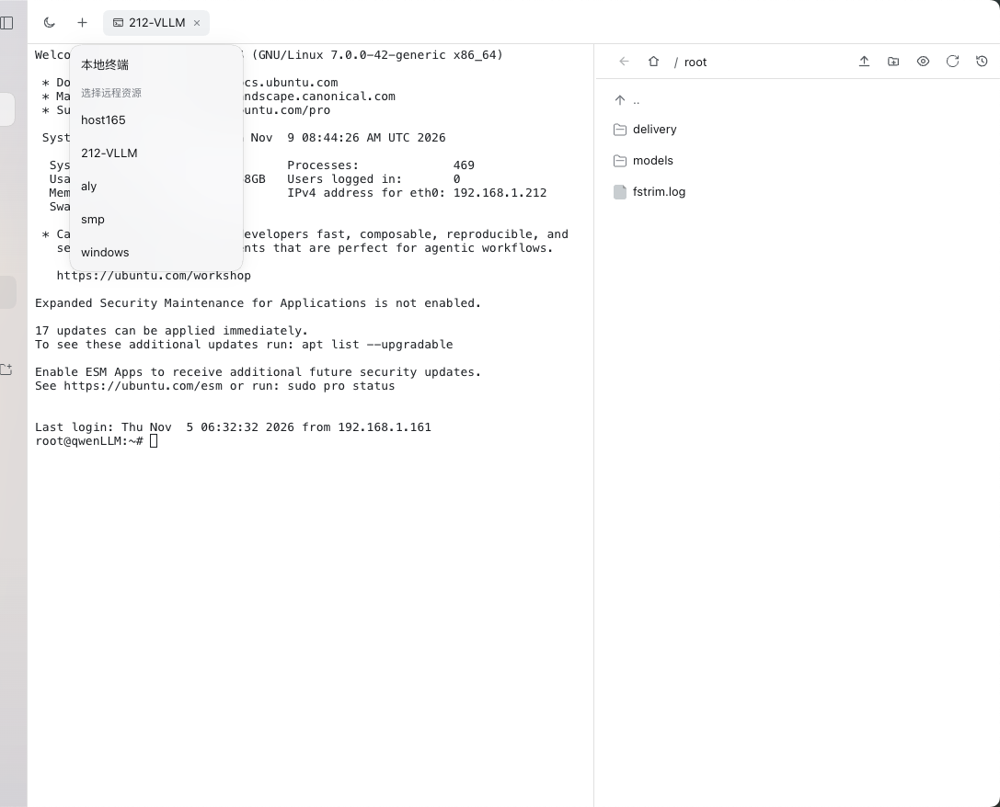
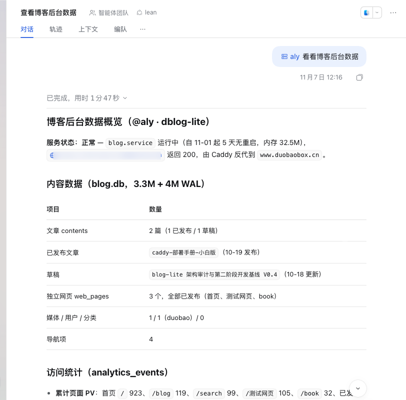
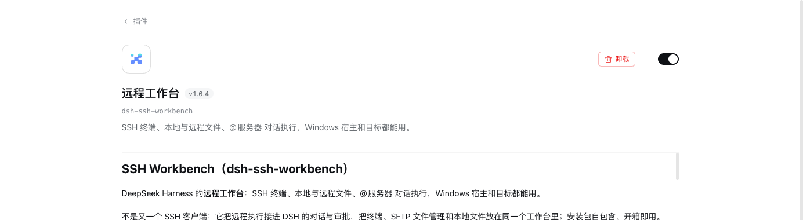

# SSH Workbench（dsh-ssh-workbench）

DeepSeek Harness 的**远程工作台**：SSH 终端、本地与远程文件、@服务器 对话执行，Windows 宿主和目标都能用。

不是又一个 SSH 客户端：它把远程执行接进 DSH 的对话与审批，把终端、SFTP 文件管理和本地文件放在同一个工作台里；安装包自包含、开箱即用。

插件不改 DSH 的本地工具语义；左侧导航提供一个独立的「远程工作台」，把终端与文件管理放在一起（本地和远程都能用）。对话里 `@资源名` 之后，命令在目标上执行：POSIX 宿主复用原生 `bash`（结果仍是原生终端卡片）；Windows 宿主没有内置 `bash`，改用插件自有的 `remote_bash`。Windows 目标（PowerShell）在两种宿主上都经 `remote_pwsh` 执行。原生 `bash` / `pwsh` 始终只在本机生效。没有 `@` 时一切行为不变。模型侧新增的工具是 `ssh_workbench_target`（切换目标）和按需出现的 `remote_bash` / `remote_pwsh`。另外保留一道**危险命令黑名单**作为兜底。

- 适用：DSH 0.2.1-rc.1 ～ 0.2.x（`engines.dsh: >=0.2.1-rc.1 <0.3.0`）
- 平台：macOS / Linux / Windows 上的 DSH；远程目标支持 POSIX 与 Windows（PowerShell）





## 能力

| 能力 | 说明 |
|---|---|
| 远程资源纳管 | 右侧栏/设置页：增删改查、连接测试、host key 指纹确认、密码/私钥凭据（0600 存储）；连接测试/选中目标后会采集 hostname 等信息（hostname 仅用于目标上下文；内核/磁盘只存储，不在列表展示） |
| `@资源` 绑定 | 消息里 `@web-1` 后，命令在 web-1 上执行（资源名支持中文/非 ASCII）；`@` 多个资源时需用 `ssh_workbench_target` 选择，未选择前远程工作台会报 `TARGET_NOT_SELECTED` 而不是静默走本地 |
| Windows 宿主 | Windows 上的 DSH 没有原生 `bash`（DSH 按平台禁用）：插件注册 `remote_bash` 用于 POSIX 目标，参数与行为对齐原生 bash 路由；原生 `pwsh` 仍只作用于本机 |
| Windows 目标 | Windows 目标经插件自有的 `remote_pwsh` 执行：命令包成 UTF-16LE 的 `-EncodedCommand` 脚本（避免引号转义），强制 UTF-8 输出并回传真实退出码；PowerShell 危险命令另有黑名单 |
| 方言探测 | 目标实际是 POSIX 还是 Windows 由连接后的 `uname -s` / `cmd /c ver` 探测并写入 `facts.dialect`，不依赖手工填写的 `platform`；探测结果用于选择 `remote_bash` / `remote_pwsh`、超时包装和目标上下文文案 |
| `remote_bash` / `remote_pwsh` | `command`、`workdir`（绝对路径 / `~/x` / 相对路径）、`timeoutMs`、取消沿用同一套语义；POSIX 目标超时后远端命令组会被终止（远端有 `timeout` 时含 `-k` 补 KILL），Windows 目标只能客户端停止等待 |
| 结果输出 | POSIX 宿主上的 POSIX 目标仍是 DSH 原生 bash 终端卡片；`remote_bash` / `remote_pwsh` 返回带 target / cwd / 退出码 / stdout / stderr 的文本结果 |
| 后台任务 | `run_in_background: true` 在远端起**脱离会话**的进程：POSIX 用 `nohup` 重定向到 `/tmp` 日志，Windows 用 `Start-Process` + 日志文件；结果返回 pid、日志路径和读取/停止命令（`tail -f` / `kill`、`Get-Content -Wait` / `Stop-Process`）。它不注册到 DSH 本地 `job_*` 注册表，进程在工具调用返回后继续运行 |
| 平台徽标 | 资源列表/设置页显示 **Linux / Windows** 徽标（来自连接后探测的 `facts.dialect`，不是手填字段）；连接测试结果也显示探测到的平台 |
| 目标切换 | `ssh_workbench_target({ server: "web-1" })`；`server: "local"` 回到本机；切换后首条命令的 stderr、bash 卡片 cwd 前缀和 composer 下方参数行都会标出当前目标 |
| 远程工作台 | 左侧导航的独立页面：左侧终端（本地终端 / 远程 SSH 终端），右侧文件管理（本地用户主目录 / 远程 SFTP，远程默认打开登录 home），文件可**在工作台内直接预览**，拖动分隔条调整宽度；每个页签一个终端会话，仅活动页签轮询、非活动页签暂停并在切回时续读（UI 能力，不占模型工具） |
| 侧边栏开关 | 插件管理 → 远程工作台 → 页面里的「在侧边栏显示远程工作台」可关闭左侧导航入口；关闭后 `@资源名` 远程执行、设置页与模型工具不受影响 |
| 危险命令黑名单 | `rm -rf /`、`mkfs`、`dd of=/dev/*`、`fdisk/parted/wipefs`、改根目录权限、fork bomb 等同步拦截；多行脚本、`&`、引号/转义、路径变体、`$()`/`eval` 都会先还原再判断；其他命令交给 DSH 审批 |

**不做**：诊断包、HTTP 探测、批量执行、远程 `read/write/edit/glob/grep`（这些工具始终只作用于 DSH 主机；远程文件操作用对应的远程 shell 工具，如 `cat`、`tee`、`sed`、`Get-Content`）。也**不做**命令分级（allow/guarded）、AI 风险解释和审计。

## 安装

DSH 插件管理里搜索 `dsh-ssh-workbench` 安装，或：

```bash
dsh plugin --profile desktop add dsh-ssh-workbench
```

从源码构建：

```bash
npm test
npm run pack
# 然后在 DSH 的插件管理里安装 dist/dsh-ssh-workbench-1.6.4.tgz
```

发布包是**自包含**的：SSH 传输依赖（纯 JS 的 ssh2 及其依赖）已放在 `vendor/` 里随包携带，安装时不会运行 `node-gyp`、不需要 Xcode Command Line Tools，也不会额外下载依赖；包体积因此略大（约 0.5 MB），换来任何机器开箱即装。组件与许可证见 `vendor/NOTICE.md`。

本地开发时，也可以在 DSH 的插件管理页直接安装本目录（Bundle 安装会读取 `package.json` 的 `dsh` 字段）。

安装后在 **设置 → 远程工作台** 里添加资源。



## 用法

1. 先说目标，再说要做什么：

```
@web-1 看下磁盘和内存
```

模型会调用 `bash`（Windows 宿主上是 `remote_bash`；Windows 目标是 `remote_pwsh`），命令实际跑在目标上。`read` / `write` / `edit` / `glob` / `grep` 仍然作用于本机；要操作远程文件，直接用远程 shell 工具：

```
@web-1 把 /etc/nginx/nginx.conf 里 worker_connections 改成 2048，改完 nginx -t
```

2. 同时提到多个资源时，模型需要先选择目标：

```
@web-1 @db-1 各自看下磁盘
→ 模型调用 ssh_workbench_target({ server: "web-1" }) → bash df -h
→ 模型调用 ssh_workbench_target({ server: "db-1" }) → bash df -h
```

3. 切回本机：

```
ssh_workbench_target({ server: "local" })
```

## 安全模型

- **黑名单兜底**：远程 `bash` / `remote_bash` / `remote_pwsh` 执行前经过同步、单调的 `ctx.tools.guard()`，命中机器毁灭类命令直接拒绝；该拦截不受审批策略影响。POSIX 规则先按 shell 语义还原（去引号/转义、剥包装、路径规范化、`$()`/`eval` 递归）再匹配，PowerShell 规则覆盖 `Format-Volume`、`Clear-Disk`、`diskpart`、`bcdedit`、整盘递归删除等；两者都只是 best-effort。
- **审批**：插件不做自己的 ask 清单，远程命令是否弹审批完全由 DSH 的会话预设（`ask` / `never`）决定。
- **凭据**：密码存于 `~/.dsh/ssh-workbench/`（0600 文件 + 本机密钥），私钥只存路径；servers.json 0600。
- **主机身份**：严格校验 known_hosts；未知指纹会显示 SHA256 并询问是否信任，由用户决定；信任后写入插件自己的 known_hosts。**如果服务器重装或更换导致指纹变化，连接会被拒绝并提示「服务器主机密钥已变化」**，核对后可在界面点「更新信任」。
- **本地文件面板**：本地文件浏览/读写/删除默认在本地用户主目录内进行（可用 `localRoot` 改到其他绝对路径）；指向目录外的符号链接与越界路径一律拒绝，删除链接只删除链接本身。
- **注意**：远程命令在服务器上执行，不受 DSH 本地文件沙箱约束；安全边界是服务器自身的权限、主机身份校验和黑名单。

## 已知限制

- **stdout/stderr 顺序**：两者是独立管道，收集后分开返回（与原生 bash 的值契约一致），交错顺序会丢失；看 `make`/`pip install` 这类日志时需要留意。
- **Windows 本地路径**：工作台本地文件面板已按 Windows 分隔符处理面包屑与文件名；极少数外部工具生成的混合分隔符路径仍可能显示成一段，可在路径编辑框直接输入绝对路径。
- **后台任务**：`run_in_background` 返回的是远端 pid + 日志，不是 DSH 本地 job id；`timeoutMs` 和取消只影响启动调用，不作用于已脱离的进程。POSIX 的 `/tmp` 日志可能被系统清理（按 tmp 策略），重要输出请自行重定向到持久目录。
- **超时终止**：远端有 `timeout` 时，超时会连同远端进程组一起终止（支持 `-k` 时再补一次 KILL，缓冲时间可用 `timeoutKillAfterMs` 调整）；远端没有 `timeout` 时只能停止等待，stderr 会提示"命令可能仍在运行"。**取消（Esc）不会立刻杀远端**：通道关闭后远端仍会计时到自己的 deadline。
- **stdin 恒为 EOF**：远程命令的 stdin 在启动后立即关闭（等价 `</dev/null`），`cat`/`read` 等读 stdin 的命令会直接得到 EOF。
- **文件工具仍在本地**：`read`/`write`/`edit`/`glob`/`grep` 不受目标影响；远程文件请走对应的远程 shell 工具或右侧栏 SFTP 面板。`working_directory` 只影响本地工具，远程目录用远程 shell 工具的 `workdir` 参数。
- **并发由 DSH 调度**：插件为单台服务器提供最多 6 条并发通道，但同一轮里多个 `bash` 调用是否并行由 DSH 的工具调度决定。
- **目标标识**：DSH 的 bash 卡片是官方渲染且没有装饰插槽，插件不替换卡片；当前用“切换后首条命令 stderr 行 + cwd 前缀（`web-1:/var/log`）+ composer 下方参数行目标指示”标出目标。
- **侧边栏开关**：开关存放在 `~/.dsh/ssh-workbench/prefs.json`，在插件管理里保存后当前窗口立即生效；关闭时左侧导航不再出现远程工作台入口，右侧栏的「远程工作台」「远程文件」页签保持不变。
- **终端生命周期**：终端会话跟随工作台页面/页签，关闭页签或离开工作台会结束会话；页面刷新/关闭时通过 `sendBeacon` 尽力补发关闭，但进程崩溃或 Host 异常退出后仍依赖 30 分钟空闲回收（尚未做跨页面保活或重连恢复）。本地终端依赖 Host 的 PTY 服务，不可用时给出提示。
- **本地文件边界**：工作台的本地文件面板与本地终端默认以**本地用户主目录**为根（`$HOME`，与常规 SSH 客户端的「本地」面板一致，面包屑显示真实路径），越界路径与指向外部的符号链接都会被拒绝；需要固定其他目录时用 `localRoot` 配置（绝对路径或 `~/...`），需要操作主目录以外的本地路径时用本地终端。远程文件仍走 SFTP，远程文件面板默认打开登录 home。
- **终端渲染资源**：xterm 随客户端 bundle 内置（`vendor/xterm.js` 只是构建输入，不再有运行时脚本路由），不依赖额外脚本路由或 CSP 放行；首次打开工作台时加载。
- **终端操作边界**：本地/远程终端是用户主动输入，不经过 agent 的审批与黑名单；SSH 权限边界不变。
- **黑名单是 best-effort**：`bash -c`、base64、脚本文件、解释器 heredoc 正文不会被解析；heredoc 正文会按可执行文本检查（fail-closed，写脚本时可能误拦）。真正的边界是 SSH 最小权限 + host-key + DSH 审批。

## 配置

在 profile 的 `cordis.patch.yml` 里覆盖（只写想改的字段）：

| 键 | 默认 | 说明 |
|---|---|---|
| `commandTimeoutMs` | `120000` | 单条远程命令默认超时；模型可用 bash 的 `timeoutMs` 覆盖 |
| `maxCommandTimeoutMs` | `1800000` | 单条远程命令超时上限 |
| `timeoutKillAfterMs` | `5000` | 远端 `timeout -k` 的宽限：TERM 后多久补 SIGKILL；0 = 只用 TERM |
| `maxOutputBytes` | `102400` | stdout 保留上限（头尾保留，中间截断） |
| `maxStderrBytes` | `16384` | stderr 独立保留上限（默认明显小于 stdout，保护上下文） |
| `transferChunkTimeoutMs` | `30000` | SFTP 分块读写看门狗；卡死时关闭会话，UI 可从 offset 续传 |
| `connectTimeoutMs` | `15000` | SSH 建连超时 |
| `hostKeyMode` | `strict` | `strict` / `accept-new` |
| `connectionPool` | `true` | 每台服务器复用一条连接 |
| `poolIdleMs` | `90000` | 空闲连接回收时间 |
| `poolMaxServers` | `8` | 连接池最多缓存的目标数 |
| `maxChannelsPerServer` | `6` | 单连接并发通道上限 |
| `prewarm` | `true` | UI 选中服务器时预热连接 |
| `targetContext` | `true` | 自动绑定 `@资源名` 并注入目标上下文；关掉后不自动绑定（仍可手动用 `ssh_workbench_target`） |
| `localRoot` | `""`（空 = 用户主目录） | 工作台本地文件面板与本地终端的根目录；必须是绝对路径或 `~/...`，非法值回退用户主目录 |

> 右侧栏的工作台开关不在 `cordis.patch.yml` 里，而是在 **插件管理 → 远程工作台** 页面里的「在侧边栏显示远程工作台」；它只影响 UI 入口，不影响模型工具。

示例：

```yaml
- id: dsh-ssh-workbench
  name: 'dsh-ssh-workbench'
  config:
    commandTimeoutMs: 300000
    maxOutputBytes: 262144
```

## 开发

```bash
npm test             # 单元测试（无需网络或真实 SSH）
npm run test:ssh     # SSH 传输集成（进程内 ssh2.Server）
npm run test:ssh:sftp # SFTP 集成（进程内 ssh2.Server）
npm run pack         # 打包到 dist/
```

更多文档：[快速上手](docs/quickstart.md) · [架构说明](docs/architecture.md) · [贡献指南](CONTRIBUTING.md) · [安全说明](SECURITY.md) · [更新日志](CHANGELOG.md)。

## 参与贡献

- 开发与提交约定见 [CONTRIBUTING.md](CONTRIBUTING.md)。
- 安全问题请按 [SECURITY.md](SECURITY.md) 私下报告，不要开公开 issue。

## License

MIT。终端渲染使用随包分发的 [xterm.js](https://github.com/xtermjs/xterm.js)（MIT），许可文本见 [vendor/XTERM-LICENSE](vendor/XTERM-LICENSE)。
